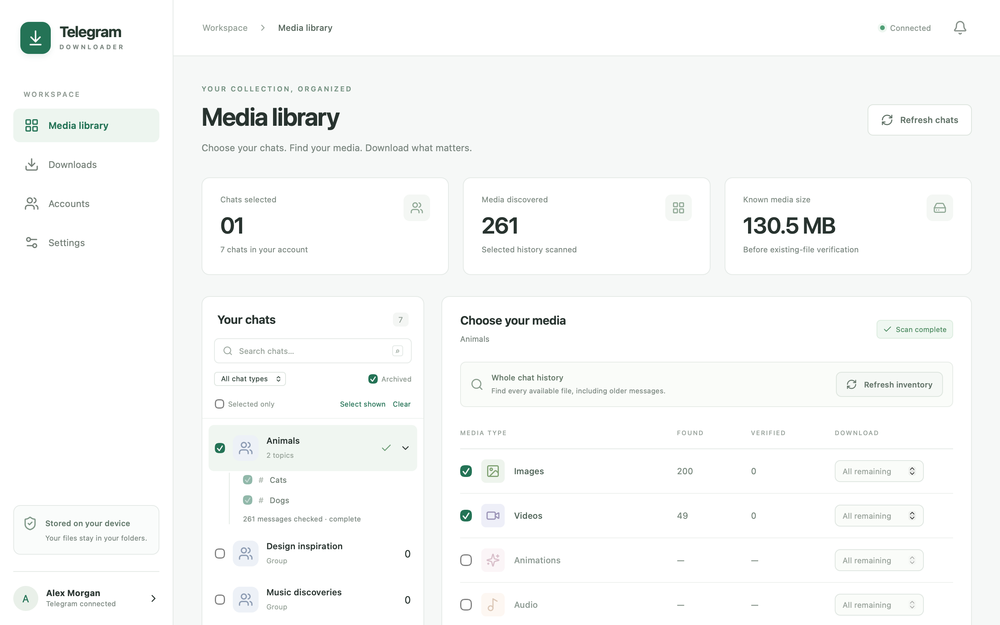
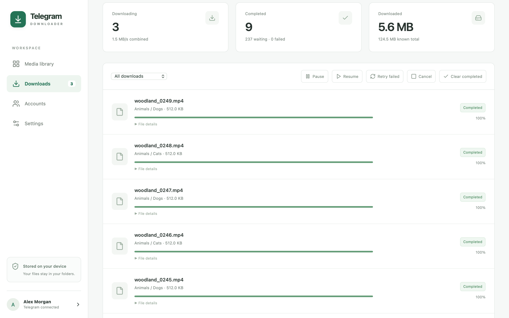
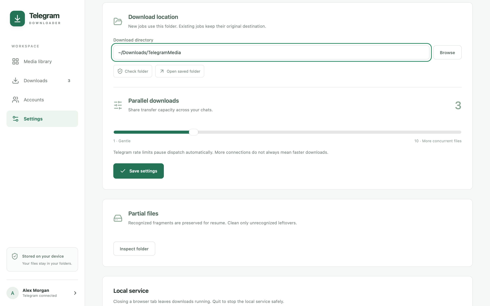

# Telegram Downloader

A bulk downloader for Telegram media with both a modern local Web interface (React + TypeScript + Vite+) and a legacy Tk desktop interface. Pick chats or forum topics, filter by media category or file extension, select specific quantities (e.g. 50 newest images and 10 videos), and stream downloads safely into organized directories with persistent resume, verification, and pause/cancel controls.



## Features

- **Web & Desktop Interfaces:** Modern responsive web UI served locally via FastAPI, plus the classic Tk interface.
- **Forum Topic Support:** Media is routed into topic-specific folders (e.g., `<output>/animals/dogs/`, `<output>/animals/cats/`, `<output>/animals/General/`).
- **Complete History Inventory:** Scans accessible cloud history in background batches and classifies items into distinct categories (Images, Videos, Audio, Documents, etc.) with accurate byte and count summaries.
- **Quantity Selection:** Choose exact amounts (e.g. 50 images, 10 videos) with order options (newest/oldest) and deduplicated parent/topic scopes.
- **Durable Catalog & Resumable Jobs:** SQLite-backed catalog persists scans, selections, and durable jobs across app restarts.
- **Safe Storage & Manifest:** Content-addressed file verification with SHA-256 digests; partial `.part` files resume from 512 KiB aligned offsets and never overwrite existing files.
- **Offline Demo Mode:** Built-in offline demo environment with simulated chats, topics, and downloads for testing without credentials.

## Setup

```bash
python3 -m venv .venv
.venv/bin/pip install -e ".[dev]"
```

For the web frontend (if building from source):

```bash
cd web
pnpm install
pnpm build
cd ..
```

## Running the Application

### 1. Web Application (Recommended)

Run the local web application:

```bash
.venv/bin/python web_launcher.py
# or after pip install -e .
.venv/bin/tg-download-web
```

This starts the local FastAPI server and opens your browser with a secure, loopback-authenticated URL (`http://127.0.0.1:8765/#token=...`).

#### Offline Demo Mode

To test or inspect the full UI and download workflow offline without a real Telegram account:

```bash
.venv/bin/python web_launcher.py --demo
```

#### Frontend Development Mode

To run with Vite live-reload:

```bash
# Terminal 1: Local API allowing the Vite dev server origin
.venv/bin/python web_launcher.py --demo --dev --no-browser

# Terminal 2: Vite dev server
cd web
pnpm dev
```

### 2. Desktop Interface (Tkinter)

The legacy desktop interface remains fully functional:

```bash
.venv/bin/python interactive_downloader.py
# or
.venv/bin/tg-download
```

## Account Setup

1. Click **Open Telegram API setup in browser** to open
   [my.telegram.org/apps](https://my.telegram.org/apps). Sign in there, then open
   **API development tools** and create an application if needed.
2. Copy the **API ID** and **API hash** into the app and click
   **Save API details & continue**.
3. **Phone number:** enter the country code and phone number in separate fields,
   then click **Send login code**.
4. **Login code:** enter the code delivered by Telegram and click **Continue**.
   You can resend the code or go back to change your phone number.
5. **Two-step verification:** if enabled on your account, enter your password and
   click **Log in**. Otherwise this screen is skipped.
6. The **Signed in** screen shows your name and Telegram profile photo; click
   **Continue to chats**. Accounts without a photo show initials instead. Photos
   load in the background and are kept only in memory.

Only the current sign-in step is visible. API setup is separate and can be
reopened with **API setup** when credentials need updating.

The browser sign-in retrieves your API application credentials; it does not sign
this downloader into your Telegram account. API IDs/hashes normally do not expire.
Login codes do expire, and account sessions can be revoked or become unauthorized.
The app reports these separately and lets you retry from **Accounts**.

### Accounts and credential updates

- **Switch accounts:** choose **Add account** to start at the phone-number screen
  using your existing API details, then sign in with the other phone number.
  Each profile gets a separate session. Choose a saved account and click
  **Connect saved account** to switch back without signing in again while
  that session remains valid.
- **Replace API credentials:** select the saved account, open **API setup**, paste its new API ID/hash,
  and click **Save API details & continue**.
- **Revoked session:** use **Add account** for a fresh session and sign in again.
- **Log out current account:** revokes only this downloader's current session.
  Saved API details remain available for a later login. Other saved sessions remain signed in.

Connecting, switching accounts, and logging out stop pending downloads and clear
this run's queue and chat selections. Completed files and recognized resumable
fragments remain on disk. Reconnect the same account and select its chats again
to continue those downloads.

Existing `.env` credentials and `TG_SESSION_NAME` are imported on first use,
keeping the original session path. Once profiles have been saved, `accounts.json`
takes precedence; logging out does not silently reactivate the `.env` account.
An optional `.env` can still contain:

```dotenv
TG_API_ID=your_id
TG_API_HASH=your_hash
TG_SESSION_NAME=downloader_session
OUTPUT_ROOT=./telegram_downloads
```

API details are stored in `accounts.json`; sessions live in `sessions/` (or the
legacy session path). These are sensitive local files, **not encrypted**. New
session directories use owner-only access, and account/session files use owner-only
permissions on POSIX systems. Login codes and two-step passwords are never saved.
The credential files are ignored by Git; keep them out of shared backups.
## Using the Web UI

Run the app on your computer (`.venv/bin/tg-download-web` or `.venv/bin/python web_launcher.py`) and it opens in your default browser at `http://127.0.0.1:8765/#token=...`. Everything runs locally on your machine—no cloud servers or third-party proxies are involved.

1. **Library & Chat Explorer**
   - Browse all dialogs (Groups, Channels, Direct Messages, Bots, and Archived chats).
   - Forum groups expand to display individual topics (including General).
   - Run a background inventory scan to discover all accessible media history without freezing the interface.
   - Quick counters show approximate server counts, while the full scan classifies every item by category with exact size and date.

2. **Quantity Selection & Preview**
   - Choose exact download quotas (e.g., 50 images and 10 videos) rather than downloading entire channel histories blindly.
   - Select order (Newest first or Oldest first) and apply optional file extension or date filters.
   - Parent chats and child topics are automatically normalized to prevent duplicate downloads.
   - Click **Preview selection** to review candidate files, destination folders, and estimated download sizes before queuing.
   - Durable jobs are saved to SQLite so your selections survive restarts.

3. **Download Queue**
   - Live stream tracking shows per-file progress, transfer speed, and completion status.
   - Scoped controls: pause, resume, cancel, or retry failed items at file, topic, chat, or global scope.
   - Clear finished items to keep your queue tidy without deleting downloaded files.
   - Persistent errors appear in the Issues drawer so failures remain actionable.

   

4. **Settings & Directory Management**
   - Set the output folder with instant disk write checks and free-space indicators.
   - Adjust concurrent downloads (1 to 10 parallel file transfers).
   - Detect and safely clean up unrecognized or abandoned `.part` fragments with confirmation.
   - One-click button to open your download directory in Finder / File Explorer.

   

### Legacy Desktop Interface (Tkinter)

The original desktop Tk GUI is still available if preferred:

```bash
.venv/bin/python interactive_downloader.py
# or
.venv/bin/tg-download
```

It supports the original chat selection, format scanning, and download controls.

## Security & Local Data Privacy

- **Runs strictly on loopback (`127.0.0.1`):** The local FastAPI service accepts connections only from loopback origins, protects against DNS rebinding, and requires a random launch token to establish an HttpOnly `SameSite=Strict` session cookie.
- **No cloud telemetry or secrets transmission:** All Telegram API IDs, hashes, and session files reside exclusively on your machine and are never transmitted to external servers.
- **Never committed to Git:** Credential files (`.env`, `accounts.json`, `*.session*`), local SQLite databases, and temporary partial files are all strictly excluded in `.gitignore`.

### Existing files, safe names, and resume

Downloads normally land in `<output_dir>/<chat name>/<file name>`. Chats with the
same sanitized title receive distinct directories, and colliding filenames receive
suffixes such as `name (2).ext`. Concurrent transfers cannot overwrite each other's
destinations.

Each output directory contains a local `.telegram-downloader.sqlite3` manifest.
It records the account, chat, message, and media identity associated with each
destination and partial file. A previous download is skipped only when its recorded
size and content digest still match. Documents with a known size must finish at
that exact size; Telegram photos allow their reported size to be an estimate.

**Files downloaded before this manifest existed are preserved.** Their names and
sizes alone cannot establish which Telegram message they came from, so the first
new run may create suffixed copies instead of skipping them. Existing folders are
reused where they can be associated safely; nothing is automatically renamed,
overwritten, or deleted to migrate old downloads.

Recognized document fragments survive pause, cancel, normal close, account
switching, and transient failures. A later attempt resumes from a supported aligned
offset. Changed media identities never reuse another file's fragment. If a resume
stream ends early without a network error, the app can retry with a full transfer.
Unindexed legacy `.part` files are preserved but are not trusted for automatic
resume; Settings cleanup can remove these unrecognized fragments after confirmation.
Cleanup excludes active transfers and valid manifest-owned partials.

The queue and selected chats are still kept in memory. After reopening the app,
select the chats and **Add to downloads** again to skip verified completed media
and resume recognized fragments. Keep the manifest with its output directory;
removing it loses that identity information and makes existing files unindexed.

`downloader.log` rotates at 5 MB (3 backups).

## Tests

No Telegram account or network is needed: suites use fake clients and temporary
output directories. UI suites require a working desktop/Tk session.

```bash
# Focused backend & download fix regression suites
.venv/bin/python -m unittest tests_auth tests_scheduler tests_storage tests_queue_state tests_scan tests_download_fixes.DownloadFixTests

# Catalog, topics, and durable jobs suite
.venv/bin/python -m unittest tests_catalog

# API endpoints and middleware suite
.venv/bin/python -m unittest tests_api

# Comprehensive smoke and Tk UI suites
.venv/bin/python tests_smoke.py
.venv/bin/python tests_ui.py
```

The focused suites cover authentication, bounded multi-chat scheduling, stop/resume
races, safe file promotion, partial-file recovery, incremental queue snapshots,
coalesced updates, and cancelled/superseded scans. See the
[implementation and validation record](docs/audits/2026-09-26/FIXES.md) for recorded
results and the distinction between fake-client checks and live Telegram behavior.
The responsiveness benchmark exercises real Tk, scheduling, and disk writes with
24 generated chat jobs and 10,000 retained rows; it saves a JSON report under
`docs/audits/2026-09-26/`. The static repaint comparison is available separately
through `bench_ui.py both`.

## Checking your chat list

To confirm the app is listing everything your account has, close the app and run:

```bash
.venv/bin/python diagnose_dialogs.py
```

It uses the active saved account (or the legacy environment session before migration),
pages both folders read-only, downloads nothing, and prints per-type counts
plus every group and channel by name. Close the GUI first — the two share one
SQLite session file.

## macOS note

If Python ever segfaults under Tk, macOS shows a "reopen windows?" alert at the
*next* launch, and Tk blocks during init waiting for that click — so the app
appears to hang on startup with no window. This repo assumes it is suppressed:

```bash
defaults write org.python.python ApplePersistenceIgnoreState -bool YES
# undo with: defaults delete org.python.python ApplePersistenceIgnoreState
```
