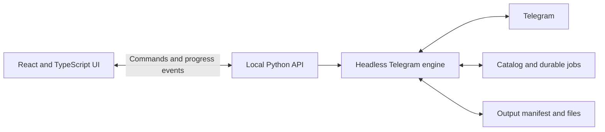

# Download improvements and web UI plan

Status: proposed implementation plan, 2026-11-14. Application changes are not implemented by this document.

Build a local web application with React, TypeScript, and Vite+, served by a Python API that owns Telegram sessions, indexing, transfers, and filesystem access. Keep the current storage safeguards and scheduler, fix their verified gaps, and make them independent of Tk before switching the main interface.

## What the repository does today

- Download discovery is not capped at 2,000 messages. `transfer_scheduler.py` requests windows of 200 and advances its cursor until history is exhausted, subject to pause, cancellation, and errors. Runnable transfer limits are separate from history depth.
- The Settings slider is for the extension preview scan: default 500 messages, up to 2,000 through the slider, or unlimited at 0. `scan_extensions()` discovers extensions, not per-category totals.
- An offline probe using the production scheduler discovered all 2,507 fabricated messages with `scan_depth=500`. A second probe with `scan_depth=0` scanned all 2,507 messages for extensions. This establishes code behavior, not live Telegram history availability.
- Downloads currently use `<output>/<chat>/<file>`. There is no explicit topic field on `DownloadItem`, topic-title cache, or topic-directory table.
- The output-local manifest persists media identity, destination, digest, and partial-file ownership. The queue, selected chats, discovery cursors, and job controls are kept in memory.
- The 67 focused tests and 137 smoke checks passed during the review. Five additional offline probes reproduced the defects in phase 1 below, using the installed Telethon 1.44.0 where relevant.

“Whole history” means the cloud history Telegram exposes to the connected account. Deleted messages and history unavailable to that account cannot be reconstructed. Telegram can also change while an inventory is being built.

## Product behavior

### Browse, count, select, download

1. Connect an account and select one or more chats, or topics inside a forum group.
2. Show a quick media summary while a cancellable full-history inventory runs in the background.
3. Show media categories, known bytes, existing-download status, and quantity controls. Keep extension, date, and size filters available as advanced filters.
4. Preview a concrete selection and its destination folders before adding it to downloads.
5. Show live progress with pause, resume, cancel, retry, and persistent issues at file, topic, chat, and all-jobs scope.

Illustrative selection for `animals / dogs`, after a complete scan and local verification:

| Media | Found | Verified on disk | Remaining | Download |
| --- | ---: | ---: | ---: | --- |
| Images | 200 | 40 | 160 | 50 |
| Videos | 49 | 9 | 40 | 10 |
| Documents | 12 | 0 | 12 | All remaining |

Recommended quantity semantics:

- Count individual downloadable media entries; an album contains multiple entries. Do not imply that message counts, album counts, and file counts are interchangeable.
- Start with Images, Videos, Animations, Audio, Voice messages, Video messages, Stickers, and Other documents. Classify using Telegram media attributes and MIME type, with extensions as a fallback. Apply an explicit precedence so every entry has one primary category; image files uploaded as documents still belong under Images.
- Default to newest first, with oldest first and date-range options. Use message ID as a deterministic tie-breaker. Category limits apply to the displayed selection scope, not once per hidden child topic.
- Normalize parent-chat and child-topic selections into a union to prevent double counting and duplicate jobs.
- `50` means select 50 eligible entries after filters and existing-file checks, not stop the history scan after 50 messages. Failed selected entries remain visible and retryable; do not silently replace them with other media.
- Exclude verified existing downloads by default. Show manifest records awaiting verification separately from verified files. File size/name alone must not establish that a legacy file has already been downloaded.
- Freeze selected media identities for a job so new messages, topic renames, or browser refreshes cannot alter its quota. Re-fetch message references before transfer as needed.
- Unlimited download jobs may stream discovery without waiting for the complete inventory. An exact quantity preview should finish indexing the requested scope first; any future early-start mode must explicitly say it covers only discovered items.

### Topic directories

```text
<output>/animals/dogs/<file>
<output>/animals/cats/<file>
<output>/animals/General/<file>
```

Resolve forum membership from topic-aware reply metadata, including direct topic posts and replies within a topic. Ordinary replies must not become topic folders. Treat General explicitly; unresolved topics use a stable `Topic_<id>` directory and remain eligible for downloading.

Cache topic metadata per account/chat and batch title lookups. Persist the topic-ID-to-directory association. Sanitize each path component, disambiguate duplicate titles and filesystem case/Unicode collisions, and keep containment checks. A rename updates the displayed title while an assigned directory stays stable.

Existing manifest-owned final files and partial files retain their paths. Newly reserved files use topic folders. Keep topic names out of the content identity so naming changes cannot force another download. Moving old files into topics is a separate optional migration, not a prerequisite for this feature.

## History indexing and count accuracy

Use two sources with distinct labels:

- **Quick Telegram counters:** `messages.getSearchCounters` accepts media filters and a forum `top_msg_id`. Respect the response's `inexact` flag. Label server counts as approximate when flagged and avoid treating Telegram's overlapping filter categories as the app's finalized category totals. These counters also do not establish local completion or exact download bytes.
- **Local inventory:** page through accessible history, classify entries, and upsert compact metadata into SQLite. Publish progressively increasing counts, cursor/checkpoint progress, errors, and a completion state. A failed or cancelled scan is partial, never “all history scanned.”

Persist the cursor and accepted metadata in the same transaction. Capture an upper message-ID boundary at scan start, keep a separate incremental cursor for newer messages, and refresh edits/deletions through updates and explicit reconciliation. Describe a complete scan as a dated inventory of the accessible range, not an immutable server snapshot. A scanned maximum ID is not itself a message count.

Reuse the shared Telegram rate-limit gate, retry/backoff, and bounded discovery concurrency. Give transfers priority over background inventory requests. Never retain the full history as Telethon objects in RAM. Build indexes for account/chat/topic/category/date and page results to the UI. Preserve checkpoint state after restart, but restart only under the corresponding authenticated account.

For a previously scanned chat, refresh the new range and reconcile changed entries rather than automatically repeating the entire scan. Offer an explicit full rescan. Missing sizes remain unknown in estimates; photos may report estimates. The byte estimate must distinguish known bytes from entries of unknown size.

## Architecture and framework choice



| Choice | Assessment |
| --- | --- |
| React + TypeScript + Vite+ | Recommended for the stateful chat/topic explorer, selection forms, and frequently updated queue. Vite+ manages frontend development, checks, tests, and builds. |
| Astro | Can host interactive components, but its content-oriented rendering model adds little for this application. Reconsider for a documentation or marketing site. |
| Python + FastAPI | Recommended local API around the existing Telethon engine. Preserve the tested download implementation and direct filesystem access. |
| Desktop wrapper | Optional later for native directory dialogs, tray integration, and a packaged window. Assess Tauri or a Python webview after the browser version reaches parity. |

Vite and Vite+ are not separate UI frameworks to stack: Vite+ supplies a coordinated toolchain built around Vite. It can improve development workflow; it does not increase Telegram transfer bandwidth. Validate any transfer-speed claim with network measurements.

Suggested boundaries:

- `engine/`: models, account authentication, Telegram adapter, media classification, catalog, job planning, scheduler, and file storage. No Tk imports or widget references.
- `api/`: FastAPI routes, request/response schemas, progress event stream, directory operations, and lifecycle control.
- `web/`: React/TypeScript interface built with Vite+; use accessible components and virtualized lists.
- `desktop/` or a launcher module only if packaging later requires it.

Separate `AuthenticationMixin` from `AccountPage` and the backend from `interactive_downloader.py`. Initially retain a compatibility entry point and Tk adapter so the existing tests and UI continue to exercise the same engine during migration.

### Local files and process ownership

The Python process performs directory listing, create/write probes, free-space checks, manifest verification, partial cleanup, file promotion, and “open in Finder/Explorer.” The UI chooses a backend-visible directory through an authenticated directory browser and path field. Browser directory handles are not portable native paths that can simply be passed to Python.

Serve the production frontend and API from one loopback origin. Keep Telegram sessions and stored credentials in Python; do not bundle them into JavaScript or browser storage. Protect local API commands and file listings with a launch/session credential, origin/host checks, and bounded filesystem operations. Return media previews by catalog identity rather than arbitrary unrestricted file-serving URLs.

Use a single backend instance to own each Telegram session and the transfer scheduler. REST commands plus Server-Sent Events are sufficient initially; use ordered event IDs, bounded buffers, and a fresh snapshot when reconnecting after missed events. Multiple tabs must not create additional workers. The HTTP layer must marshal commands onto the engine's existing asyncio loop until loop ownership is deliberately refactored.

Closing or reloading a browser tab leaves downloads running while the local process remains alive. Explicit Quit stops workers cleanly and checkpoints jobs. A service restart offers recovery of interrupted work; logging out or switching accounts cannot run the previous account's jobs under another session. The frontend bundle is built ahead of distribution, so the release does not require a Vite development server or a Node server at runtime.

Use an app-data SQLite database for the catalog, scan checkpoints, saved selections, and durable jobs. Keep each output directory's existing manifest authoritative for file identity and completion. Because the two databases cannot share a transaction reliably across output locations, recover idempotently: reconcile a job item with the output manifest after a crash, and use stable request IDs to avoid duplicate enqueue operations. Detect a missing/remounted output volume and ask for its original directory before continuing; do not silently redirect an existing job.

## Implementation phases

### 1. Repair the five verified download defects

- Add CDN-aware recovery for resumed downloads; a redirect must not become an immediate terminal failure. Keep any use of Telethon internals inside a version-tested adapter.
- Explicitly close resumed download iterators on success, exceptions, and cancellation, returning borrowed connections after disk writes have drained.
- Configure Telethon to preserve the last RPC error and classify transient server/network errors separately from permanent failures. Disk-full and permission failures should expose an actionable state instead of repeated blind retries.
- Allow chats with queued work to use slots that other chats cannot fill while preserving fair admission and dispatch.
- Move hashing and long copies out of the shared storage lock, using per-media ownership and short transactions. Revalidate before promotion so collision and cancellation guarantees survive.

Acceptance: reproduce each reviewed failure in a regression, then demonstrate its corrected result. Include the 10-slot/three-chat uneven workload, cancellation during a borrowed-connection transfer, and a blocked hash while another media reservation proceeds. All existing offline suites must still pass. Benchmark disk and network separately.

### 2. Extract the engine and establish the local web boundary

Introduce engine models/services and the local API. Build a small React/Vite+ vertical slice covering connection status, chat listing, directory validation, and one download's live state. Keep development and release launch paths distinct.

Acceptance: the headless engine imports and runs without Tk; the old UI and API exercise the same scheduler; two tabs do not duplicate transfers; origin/session checks protect commands; reloading the page reconnects to the existing job.

### 3. Add the durable catalog and topic-aware storage

Implement SQLite migrations, full-history indexing, quick counters, exclusive media classification, topic resolution, and topic-folder reservations. Persist scan checkpoints and separate complete, partial, paused, and failed inventory states. Centralize compatibility for topic APIs in the supported Telethon version range; raise the minimum tested version if necessary.

Acceptance: history beyond 2,000 messages is fully indexed, repeated/failed pages neither skip nor double-count media, cancelled scans resume, and old credentials/files/manifests remain usable. Verify General, nested replies, duplicate or renamed topic titles, unknown/deleted topics, and case/Unicode path collisions. A six-media album counts as six eligible entries, not one.

### 4. Add selection planning and durable downloads

Implement per-category quantities, scope normalization, newest/oldest order, date/size/extension filters, destination and byte previews, and persisted jobs/items. Resolve existing-file verification before finalizing the selected quantities. Persist stable identities instead of serialized live Telethon message objects.

Acceptance: choosing 50 images and 10 videos produces exactly that many distinct planned entries when available; parent/topic overlaps do not duplicate them; failed items do not consume or replace another entry silently. Restarting during transfer or between file promotion and job commit recovers against the output manifest. Account switches preserve account isolation and discoverable recovery state.

### 5. Complete the web UI and switch the primary launcher

Build the account flow, expandable chat/topic explorer, inventory summary, selection table, download queue, persistent issue drawer, and settings. Expose counting/verification status, estimated bytes, free space, retry countdown, speed, and ETA without freezing controls. Fetch thumbnails only on demand with a bounded cache.

Retain keyboard navigation, selected-only filters, archived chats, per-chat and global controls, directory opening, and safe partial cleanup. Add explicit topic scope to controls and distinguish “scanning complete” from “downloads complete.” Use paginated/virtualized lists and coalesced progress events rather than repainting all history for every chunk.

Acceptance: browser end-to-end tests cover API setup, login code and 2FA, account switching, full scan, topic selection, quantities, folder checks, pause/resume/retry, cleanup, tab reload, and restart recovery. Run a large-inventory responsiveness scenario and record p95 interaction latency. Retire the Tk launcher only after the parity matrix below passes.

### 6. Validate on Telegram and package

Use a user-authorized account and chosen test chats to validate forum coverage, counts, CDN behavior, rate limits, stale references, interrupted networks, large files, and throughput. Test disk-full, missing output volumes, and process termination with disposable data. Offline probes cannot establish real Telegram bandwidth or universal server behavior.

Ship a launcher that starts the local service, opens the UI, prevents duplicate instances, and provides explicit shutdown. Decide on a desktop wrapper after measuring startup, native dialog needs, and packaging effort. Consider per-file parallel range downloading only if profiling shows sequential requests are the bottleneck; extra concurrency must not compromise resumability or rate-limit handling.

## Functionality parity before replacing Tk

| Existing capability | Required web behavior |
| --- | --- |
| API setup, phone/code/2FA, saved accounts, logout | Complete API-backed account flow; secrets remain backend-owned |
| All chats including archived, search, selected-only view | Searchable, virtualized explorer with preserved selections |
| All files and extension filtering | Category controls plus extension filters and unlimited-history choice |
| Per-file/chat/global pause, resume, cancel, retry, clear completed | Same semantics, plus clearly scoped topic controls |
| Safe names, collisions, digest verification, partial resume | Same storage invariants and legacy-file handling |
| Output directory, concurrency, scan settings | Backend directory browser, real write checks, capacity display, settings persistence |
| Orphan cleanup and open folder | Backend-owned actions preserving active/resumable files and confirmation for cleanup |
| Persistent errors and account-reset isolation | Issue drawer, reconnect-safe state, no old-account event leakage |
| Normal shutdown | Explicit service shutdown with durable job recovery |

## Defaults to carry into implementation

Use React/TypeScript/Vite+ and a local FastAPI service; keep the established Python engine. Make all-history inventory an explicit readable choice instead of hiding it behind a slider value of zero. Default quantity selection to newest eligible media, preserve assigned topic directories on rename, and offer recovery after service restart. Preserve the current behavior that account switching stops that account's active work; saved jobs become available when that account reconnects.

Do not promise that a framework migration alone makes downloads faster or that browser filesystem APIs preserve desktop functionality automatically. Phase 1 addresses measured implementation defects; backend-owned files and the parity checks preserve functionality; the web UI improves navigation and selection.

## Sources checked

- Repository: `interactive_downloader.py` (`scan_extensions`, `_make_download_item`, `_download_worker`, `_download_resumed`, Settings), `transfer_scheduler.py`, `download_storage.py`, `telegram_auth.py`, and the offline suites.
- [Vite+](https://viteplus.dev/): unified Vite-based frontend toolchain; the live page reports version 1.0 and MIT licensing.
- [Astro design goals](https://docs.astro.build/en/concepts/why-astro/): content-oriented architecture and support for interactive UI frameworks.
- [Telegram media counters](https://core.telegram.org/method/messages.getSearchCounters): media filters and topic-scoped counts.
- [Telegram count accuracy flag](https://core.telegram.org/constructor/messages.searchCounter): server counts can be marked inexact.
- [Browser directory picker](https://developer.mozilla.org/en-US/docs/Web/API/Window/showDirectoryPicker): browser support and permission constraints justify backend-managed directory access.

No live Telegram session was used for this planning work. Implementation, browser parity tests, and live-transfer acceptance remain future work.
